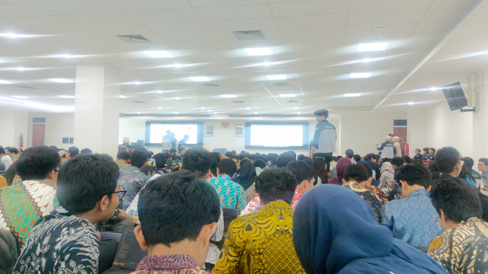
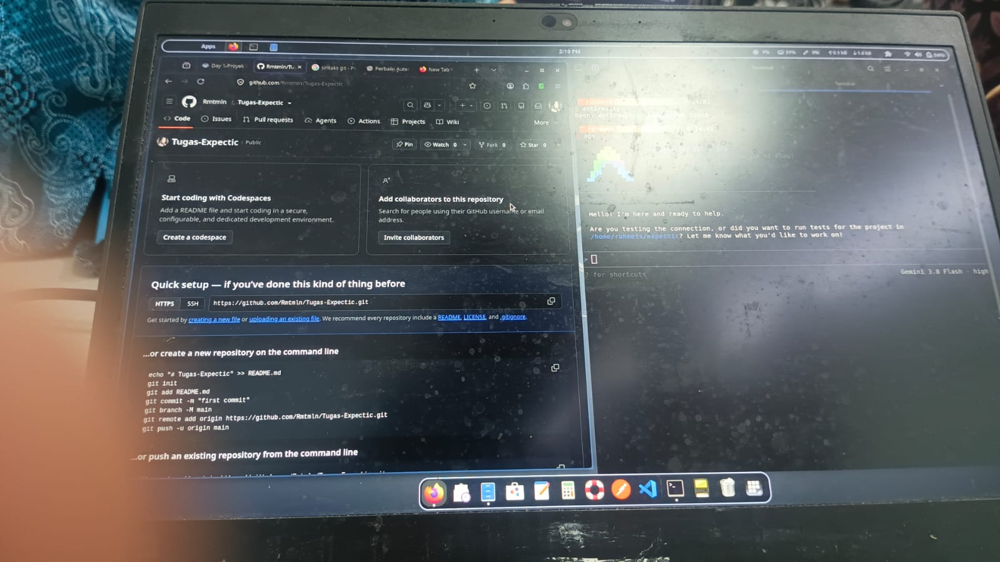
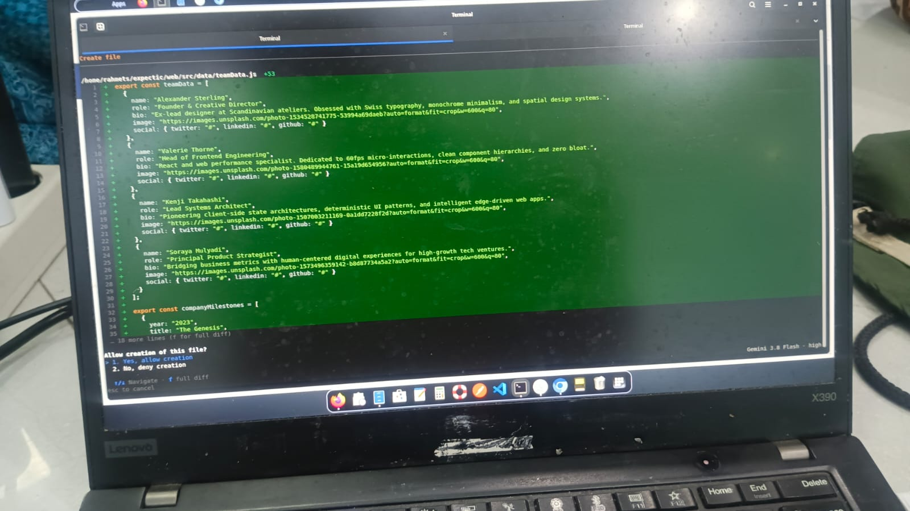
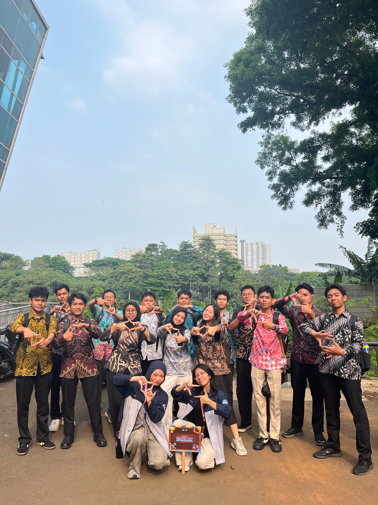

# Day 1 Workshop: From AI to GitHub

**Nama Lengkap:** Abid Rahmat Maulana
**Kelompok:** [Roblox Kelompok 24]
**Workshop:** Building with AI, Managing Change with GitHub
**Pemateri:** Nugi Farhan (Senior Product Designer)

---

## Deskripsi Singkat Repository

Repository ini adalah rumah buat semua catatan dan dokumentasi yang saya kumpulkan selama mengikuti Day 1 workshop. Isinya bukan kode yang rumit. Lebih ke jurnal belajar: apa yang disampaikan pemateri, apa yang nyangkut di kepala, dan apa yang menurut saya patut dicatat.

Tujuan dan Kegunaan Repository

- Jadi tempat penyimpanan dokumentasi workshop secara online.
- Latihan langsung membuat dan mengelola repository GitHub dengan visibilitas Public.
- Membiasakan diri mencatat materi dengan rapi, bukan cuma ditumpuk di galeri HP.
- Latihan menulis `README.md` sebagai dokumentasi utama sebuah proyek.
- Jadi bahan buka-buka ulang kalau nanti lupa soal prompt, Git, atau urusan SSH key yang bikin pusing.

## Informasi Kegiatan Workshop yang Didokumentasikan

Day 1 membahas dua sisi dari satu alur kerja: **membuat dan mengembangkan** produk dengan bantuan AI, lalu **mengelola perubahan dan kolaborasi** lewat Git dan GitHub. Capaian yang ditargetkan pada hari ini:

1. Menjelaskan bagaimana prompt AI yang lebih spesifik menghasilkan output yang lebih baik.
2. Membedakan apa itu Git dan apa itu GitHub.
3. Mengidentifikasi repository, commit, branch, dan pull request.
4. Melakukan version controlling.

Proyek latihan yang dibangun di sesi ini adalah **Student Task Planner**, sebuah aplikasi web sederhana untuk mencatat tugas dan tenggat bagi mahasiswa baru.

Dokumentasi kegiatan (rangkuman, poin penting, dan pendapat pribadi) ada di bagian bawah file ini.

---

# Dokumentasi Kegiatan Workshop

## 1. Rangkuman Materi

### 1.1 Prompt Engineering

Prompt engineering adalah cara merancang instruksi supaya AI memberi jawaban yang tepat, relevan, dan layak dipakai. Prompt sendiri bisa berupa pertanyaan sederhana, kata kunci, instruksi panjang, sampai potongan kode.

**Konteks itu kunci.** Prompt "Create student task planner" cuma segini doang, dan AI terpaksa menebak sisanya. Prompt yang disertai konteks (siapa penggunanya, fitur apa saja, batasan teknis, format output) bikin hasilnya jauh lebih terarah.

**Struktur prompt yang baik:**

| Komponen | Fungsi |
|----------|--------|
| Role | Menentukan peran AI dalam tugas ini |
| Task | Tujuan atau hal yang mau dikerjakan |
| Context | Requirement dan constraint yang melingkupi tugas |
| Format | Bentuk output yang diminta (kode per file, cara menjalankan, cara tes) |

**Taktik tambahan** (dari Google Cloud):
- Pakai kata kerja yang jelas untuk menyebut aksi yang diinginkan.
- Tentukan panjang dan format output.
- Sebutkan target audiens.
- Sertakan fakta dan data yang relevan.
- Rujuk dokumen atau sumber tertentu.
- Definisikan istilah kunci.

**Keuntungan prompt engineering:**
- Performa model AI meningkat.
- Bias dan respons yang ofensif berkurang.
- Kontrol dan prediktabilitas lebih baik.
- Pengalaman pengguna jadi lebih enak.

### 1.2 Git

Git adalah *distributed version control system* (DVCS) yang melacak siapa, kapan, dan apa saja yang berubah dalam sebuah file. Git diciptakan oleh Linus Torvalds pada 2005 dan bekerja secara lokal di komputer kita.

**Alur kerja Git (tiga area):**

```
Working Directory  --(git add)-->  Staging Area  --(git commit)-->  .git Directory (Repository)
```

- **Working directory**: salinan satu versi proyek yang sedang dikerjakan, tempat file diedit.
- **Staging area (index)**: tempat menampung perubahan yang akan masuk ke commit berikutnya.
- **Git directory**: tempat Git menyimpan metadata dan object database. Ini komponen terpenting, dan bagian inilah yang disalin saat kita `clone` repository.

### 1.3 Git vs GitHub

| | Git | GitHub |
|---|-----|--------|
| Jenis | Version control system terdistribusi | Platform berbasis web |
| Fungsi | Melacak dan mengelola perubahan kode secara **lokal** | Menyimpan repository Git secara **online** dan mendukung kolaborasi |

Singkatnya, Git adalah mesinnya, GitHub adalah garasi bersama tempat mesin itu diparkir.

### 1.4 Command Dasar

```bash
git init                         # memulai repo baru
git add .                        # memindahkan file ke staging area
git commit -m "pesan"            # menyimpan perubahan ke repository
git remote add origin <url>      # menghubungkan repo lokal ke GitHub
git push origin main             # mengirim branch saat ini ke remote
git pull origin main             # mengambil perubahan lalu merge ke branch saat ini
git clone "url"                  # menyalin repo dari GitHub ke komputer
```

**Variasi `git add`:**
- `git add --all` dan `git add -A` berperilaku sama, menambahkan semua perubahan di repo ke staging area.
- `git add .` menambahkan semua file di direktori saat ini beserta isinya.
- `git add *` menambahkan file yang dimodifikasi atau baru, tetapi tidak file yang dihapus (sesuai penjelasan slide).

### 1.5 Setup Environment

**Git:**
1. Install Git sesuai perangkat.
2. Cek dengan `git --version`.
3. Atur identitas:
   ```bash
   git config --global user.name "Your Name"
   git config --global user.email "your-email@example.com"
   ```
4. Cek konfigurasi dengan `git config --global --list`.

**VS Code:**
1. Install VS Code.
2. Tekan `Cmd/Ctrl + Shift + P`, cari *Shell Command: Install 'code' command in PATH*.
3. Cek lewat terminal dengan `code --version`.

**SSH Key untuk GitHub:**
1. Generate key: `ssh-keygen -t ed25519 -C "email@domain.com"`. Tekan Enter untuk lokasi default, lalu isi passphrase (atau Enter dua kali kalau tidak mau).
2. Jalankan SSH agent: `eval "$(ssh-agent -s)"`.
3. Atur `~/.ssh/config` untuk `Host github.com` (AddKeysToAgent, UseKeychain, IdentityFile).
4. Tambahkan key ke agent: `ssh-add --apple-use-keychain ~/.ssh/id_ed25519`.
5. Salin public key (`pbcopy < ~/.ssh/id_ed25519.pub`), lalu tempel di GitHub pada **Settings > SSH and GPG keys > New SSH key**.
6. Verifikasi dengan `ssh -T git@github.com`. Kalau berhasil, muncul pesan bahwa autentikasi sukses tetapi GitHub tidak menyediakan akses shell.

Catatan kecil soal nama: **Ed25519** adalah skema tanda tangan digital berbasis kurva eliptik (EdDSA di atas Curve25519, karya Daniel J. Bernstein) yang dirancang untuk keamanan dan performa tinggi.

### 1.6 Praktik: Student Task Planner

Alur praktik yang dipandu di akhir sesi:

1. Install platform AI (Claude, Antigravity, ChatGPT).
2. Tulis prompt untuk membuat web atau aplikasi.
3. Masukkan ke Git dengan `git init`.
4. Commit dan push ke GitHub.
5. Lakukan perubahan.
6. Commit dan push lagi.

---

## 2. Poin-Poin Penting dan Pengetahuan Baru

- **Prompt asal-asalan menghasilkan jawaban asal-asalan.** Role, Task, Context, dan Format itu bukan hiasan, itu pagar supaya AI tidak melantur.
- Menambahkan kalimat seperti "jangan klaim aplikasinya jalan sebelum kamu verifikasi" ternyata trik yang cerdas untuk mengurangi AI yang sok yakin.
- **Git dan GitHub itu dua hal berbeda.** Git jalan di laptop, GitHub adalah layanan online. Sebelumnya saya sering menganggap keduanya satu paket.
- Ada **tiga area** dalam Git (working directory, staging area, repository), dan commit hanya merekam apa yang sudah masuk staging.
- Urutan dasarnya selalu `add`, lalu `commit`, lalu `push`.
- Autentikasi lewat **SSH key** lebih rapi daripada mengetik kredensial berulang-ulang, tapi setup awalnya butuh ketelitian.
- Ada kebiasaan yang patut ditiru dari slide: sebelum mulai kerja, **cek setup** (versi Git, identitas, VS Code, koneksi GitHub).
- Pesan commit sebaiknya jelas, karena nanti dia yang jadi jejak sejarah proyek.

---

## 3. Pendapat Pribadi tentang Day 1

Jujur saja, Day 1 ini lebih padat dari bayangan saya. Kelihatannya cuma "belajar Git", tapi ternyata diawali dulu dengan prompt engineering, dan menurut saya urutan itu pas. Bagian prompt bikin saya sadar kalau selama ini saya sering menulis perintah ke AI seenaknya, lalu menyalahkan hasilnya.

Bagian paling menantang buat saya adalah setup SSH key. Banyak langkah, banyak perintah, dan satu salah ketik saja bisa bikin ngadat. Tapi begitu muncul pesan *successfully authenticated*, rasanya lumayan puas.

Hal yang paling saya suka adalah praktiknya. Teori Git bisa terasa kering, tapi begitu benar-benar `commit` dan `push` ke repo sendiri, semuanya jadi masuk akal. Ke depan saya ingin lebih rajin commit kecil-kecil dan belajar soal branch serta pull request lebih dalam.

---


---
## Dokumentasi Foto






---

## Status Repository

- Visibilitas: **Public**
- Pemilik: Abid Rahmat Maulana
- Semua file dokumentasi tersimpan dalam satu repository ini.

*Dibuat sebagai bagian dari Misi Proyek Workshop Day 1.*
